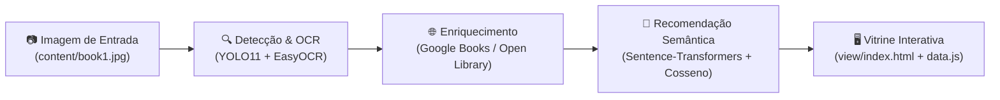

# 📚 ShelfScanner AI

**ShelfScanner AI** é uma aplicação inteligente em **Python** e **Machine Learning** que analisa fotos de estantes ou capas individuais de livros utilizando Visão Computacional e Processamento de Linguagem Natural (NLP) para gerar recomendações literárias personalizadas em uma vitrine web interativa.

---

## 🔍 Visão Geral e Arquitetura do Pipeline

O projeto opera em um pipeline automatizado de três etapas principais, combinando detecção de objetos, reconhecimento óptico de caracteres (OCR), enriquecimento de dados via APIs literárias e busca semântica por embeddings multilíngues:



### 1. Detecção e OCR (`detec_extract_books.py`)
- **Detecção de Livros:** Recebe uma imagem da pasta `content/` e utiliza o modelo **YOLO11** (`ultralytics` — `yolo11n.pt`, classe COCO `73: book`) para localizar múltiplos livros ou lombadas na estante, gerando também uma imagem de inspeção (`debug_yolo.jpg`).
- **Leitura Inteligente e Fallbacks:** Extrai o texto de cada recorte usando **EasyOCR** (configurado para português e inglês).
  - **Rotação de Lombadas:** Caso a razão de aspecto indique um livro na vertical, aplica rotações automáticas de 90° (horária e anti-horária) para garantir a leitura correta da lombada.
  - **Fallback de Capa Inteira:** Se o YOLO não isolar caixas delimitadoras (ex.: foto aproximada de uma única capa), o sistema analisa a imagem completa filtrando os maiores blocos tipográficos (título e autor em destaque) e testa rotações caso necessário.
- **Enriquecimento de Metadados:** Consulta a **Google Books API** (com fallback automático para a **Open Library API**) para validar a obra e obter metadados oficiais completos: título padronizado, autores, sinopse, categorias e capa em alta resolução.

### 2. Recomendação Semântica (`recommended_books.py` / `recommend_books.py`)
- **Embeddings Multilíngues:** Combina título, categorias e sinopse dos livros identificados na estante e gera vetores densos de representação semântica utilizando o modelo `paraphrase-multilingual-MiniLM-L12-v2` (`sentence-transformers`).
- **Perfil do Leitor e Ranqueamento:** Calcula o vetor médio do perfil literário do usuário e compara com o catálogo dinâmico de obras candidatas por meio de **Similaridade de Cosseno** (`scikit-learn`), filtrando livros já presentes na estante e ordenando as recomendações mais compatíveis.

### 3. Orquestração e Visualização (`main.py` + `view/`)
- **Fluxo Ponta a Ponta (`main.py`):** Coordena a leitura da imagem em `content/`, constrói dinamicamente o catálogo de livros candidatos com base nos temas e autores detectados e executa o motor de recomendação.
- **Exportação e Interface Web (`view/`):** Exporta as recomendações geradas (título, autor, sinopse, categorias, URL da capa e percentual de compatibilidade) para `view/data.js` (`window.SHELF_DATA`) e abre automaticamente a vitrine interativa (`view/index.html`) no navegador padrão.
- **Recursos da Vitrine (`index.html`, `style.css`, `script.js`):**
  - Cards visuais com selo de percentual de compatibilidade (*Match %*).
  - Busca em tempo real por título, autor, categoria ou palavra-chave.
  - Ordenação dinâmica por maior compatibilidade ou ordem alfabética (A–Z).
  - Modal interativo para leitura da sinopse completa e metadados detalhados.

---

## 📁 Estrutura de Pastas

```text
shelfscanner-ai-books/
├── content/
│   └── book1.jpg               # Imagem de entrada (estante ou capa de livro)
├── view/
│   ├── index.html              # Estrutura da vitrine web interativa
│   ├── style.css               # Estilização moderna e responsiva da interface
│   ├── script.js               # Lógica de renderização, busca, filtros e modal
│   └── data.js                 # Payload de recomendações gerado automaticamente pelo pipeline
├── main.py                     # Orquestrador principal do pipeline e abridor da interface web
├── detec_extract_books.py      # Módulo de visão computacional (YOLO11 + EasyOCR) e consulta às APIs
├── recommended_books.py        # Motor de recomendação semântica (Sentence-Transformers + Cosine Similarity)
├── yolo11n.pt                  # Pesos do modelo YOLO11 Nano (baixado/carregado automaticamente)
└── README.md                   # Documentação do projeto
```

> **Nota:** No repositório, o módulo de recomendação pode estar nomeado como `recommend_books.py` (importado em `main.py`) ou `recommended_books.py`.

---

## ⚙️ Pré-requisitos e Instalação

### Pré-requisitos
- **Python 3.9+** instalado
- Conexão com a internet (para consulta às APIs Google Books / Open Library e download inicial dos pesos dos modelos YOLO11, EasyOCR e Sentence-Transformers)

### Instalação das Dependências

No terminal, dentro do diretório raiz do projeto, instale os pacotes necessários com o comando abaixo:

```bash
pip install ultralytics opencv-python easyocr requests sentence-transformers scikit-learn
```

---

## 🚀 Como Usar (Passo a Passo)

### 1. Adicione uma foto na pasta `content/`
Coloque a foto da sua estante de livros ou de uma capa individual dentro do diretório `content/` com o nome padrão esperado pelo script:

```text
content/book1.jpg
```

*(Caso queira utilizar outro nome de arquivo, basta ajustar a variável `photo_path` no bloco principal de `main.py`).*

> 💡 **Dica para melhores resultados:** Utilize fotos bem iluminadas e com os títulos das lombadas ou capas legíveis. O sistema suporta tanto estantes com vários livros (horizontais ou verticais) quanto fotos de uma única capa.

### 2. Execute o pipeline principal
No terminal, execute o script orquestrador:

```bash
python main.py
```

### 3. Acompanhe o processamento e explore as recomendações
Durante a execução, o terminal exibirá o progresso de cada etapa:
1. Detecção dos livros via **YOLO11** e extração de texto via **EasyOCR** (gerando `debug_yolo.jpg` na raiz para conferência visual das detecções).
2. Busca de metadados e construção dinâmica do catálogo de candidatos via **Google Books API** / **Open Library API**.
3. Cálculo dos embeddings e ranqueamento por **Similaridade de Cosseno**.
4. Atualização automática do arquivo `view/data.js` e abertura imediata da página `view/index.html` no seu navegador com as recomendações personalizadas.

---

## 🛠️ Tecnologias Utilizadas

| Camada | Tecnologia / Biblioteca | Finalidade |
| :--- | :--- | :--- |
| **Detecção de Objetos** | `ultralytics` (YOLO11) & `opencv-python` | Identificação de livros/lombadas, recorte e rotação de imagem |
| **OCR** | `easyocr` | Extração de texto multilíngue (Português / Inglês) em capas e lombadas |
| **Metadados Literários** | `requests` (Google Books & Open Library) | Enriquecimento com título oficial, autor, sinopse, categorias e capa |
| **NLP & Recomendação** | `sentence-transformers` & `scikit-learn` | Embeddings semânticos (`paraphrase-multilingual-MiniLM-L12-v2`) e Similaridade de Cosseno |
| **Front-end** | HTML5, CSS3, JavaScript Vanilla | Vitrine interativa com filtros, ordenação e visualização em modal |
